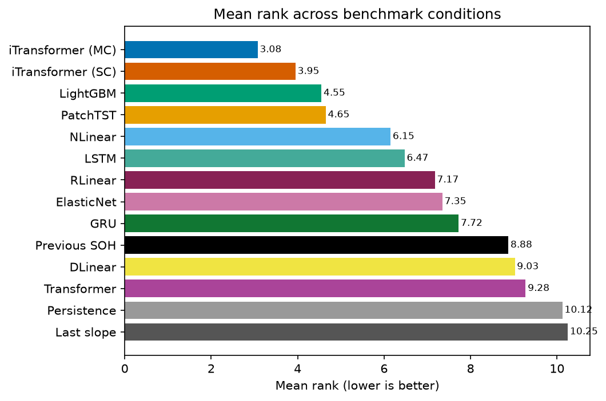
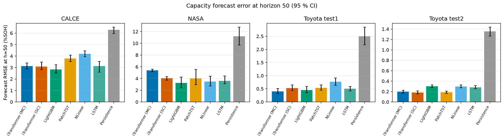
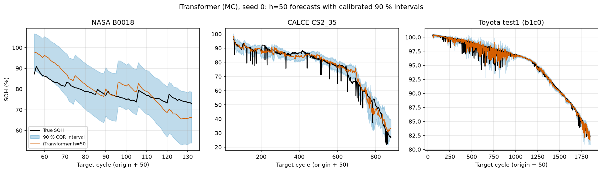
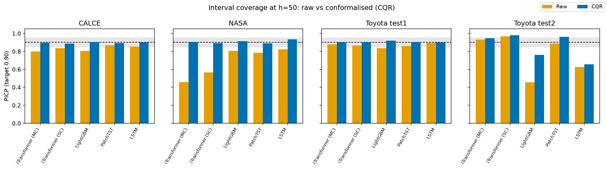

# battery-rul-transformers

[](https://github.com/anuragjha6557/battery-rul-transformers/actions/workflows/ci.yml)
[](https://huggingface.co/spaces/anurag6557/battery-rul-itransformer-v2)

A leakage-free benchmark for lithium-ion battery **State-of-Health (SOH) estimation, capacity forecasting and Remaining-Useful-Life (RUL) prediction**. It covers NASA PCoE, CALCE and Toyota/MIT-Stanford (Severson 2019, 124 LFP cells), and adds **iTransformer-v2**: inverted-attention forecasting with direct multi-horizon quantile heads and conformal (CQR) prediction intervals.

The project was rebuilt from scratch from the idea in Jha, Dorkar, Biswas & Emadi, *iTransformer Network Based Approach for Accurate Remaining Useful Life Prediction in Lithium-Ion Batteries*, IEEE ITEC 2024 ([doi:10.1109/ITEC60657.2024.10598898](https://doi.org/10.1109/ITEC60657.2024.10598898)). The paper's reported numbers were deliberately **not** used as a target.

**📊 Project showcase (EDA → method → results → uncertainty → ablations):** [interactive page](https://anurag6557-battery-rul-itransformer-v2.static.hf.space/showcase.html)

**▶ Try it:** [huggingface.co/spaces/anurag6557/battery-rul-itransformer-v2](https://huggingface.co/spaces/anurag6557/battery-rul-itransformer-v2). Upload a `cycle_idx,capacity_ah` CSV (or pick a demo cell) and get an SOH forecast and a RUL estimate with calibrated 90 % intervals, plus an out-of-distribution warning. The model runs in your browser (ONNX Runtime Web), so your data never leaves the page.

## What this project shows
1. **The answer depends on the dataset.**
   - Inverted attention (iTransformer) has the best mean rank across 40 dataset × task × metric conditions. It leads in-distribution on Toyota, where hyperparameters were tuned and 83 test cells give real statistics.
   - On 4-cell NASA/CALCE, a tuned LightGBM or ElasticNet matches or beats it ([ADR-0008](docs/decisions/0008-baseline-findings.md)).
2. **One-step and early-life metrics cannot separate models.**
   - At CALCE's fixed start points, nothing beats "SOH stays the same" (persistence).
   - Multi-horizon, all-origin evaluation does separate them. That is why this benchmark reports direct h = 1…200 forecasts, three tasks kept apart, and RUL at fixed start points with α-λ accuracy ([PROTOCOL.md](PROTOCOL.md)).
3. **Calibrated uncertainty.**
   - Raw quantile intervals under-cover: iTransformer covered 46 % on NASA at h = 50 against a 90 % target.
   - Split-conformal CQR brings 30 of 40 forecast conditions into 90 ± 5 %.
   - Coverage still fails under distribution shift (Toyota test2), and the demo warns about exactly that case ([ADR-0011](docs/decisions/0011-uq-method.md)).
4. **Cross-chemistry transfer is conditional.**
   - Pre-training on Toyota (LFP) and fine-tuning cuts NASA h = 50 error by 28 %, because NASA cells are short and data-poor.
   - It slightly hurts CALCE, whose cells are long-lived.
   - Zero-shot transfer fails ([ADR-0012](docs/decisions/0012-toyota-transfer.md)).
5. **Negative results are reported.**
   - Physics-informed ICA/ΔQ(V) features, RevIN and Huber loss were each pre-registered and each failed the decision rule ([ADR-0009](docs/decisions/0009-curve-features.md), [ADR-0013](docs/decisions/0013-normalisation-and-loss.md)).
   - Direct heads beat recursive rollout by 1.2–5.6× at h = 50 ([ADR-0010](docs/decisions/0010-direct-vs-recursive.md)).

**Rigor:**
- Leave-one-cell-out with inner cross-fitting on NASA/CALCE; the official Severson split on Toyota.
- Scalers fitted on training cells only, with 7 leakage rules enforced by mutation-tested unit tests.
- Equal-budget Optuna tuning: 50 trials per model × task.
- 5 seeds, cluster-bootstrap CIs, and Holm-corrected Wilcoxon tests on Toyota.
- Every number traces to an MLflow run ID.
- The Severson 2019 variance model is reproduced: 14.8 % / 11.4 % test error ([report](reports/tables/severson_repro.md)).

## Field setting: no SOH history
The results above assume a measured capacity log. A real battery management system (BMS) does not have one. It sees charge-side quantities, rest time, resistance, temperature and the cycle count. Phase 2 re-asks the three tasks with those inputs only: SOH estimation (F-A), capacity forecasting (F-B) and RUL (F-C). Capacity and SOH are labels, never inputs, and leakage tests enforce it ([ADR-0018](docs/decisions/0018-outlier-policy-and-field-inputs.md)). Outliers are cleaned by a causal policy for inputs and a hindsight policy for labels. The field EDA is in [reports/eda_field.md](reports/eda_field.md).

**Findings** (tables are in the generated results below; [ADR-0020](docs/decisions/0020-field-benchmark.md)):
1. **Field signals beat age-only on Toyota and CALCE.**
   - On Toyota, every learned model beats the age-only baseline, except ElasticNet on test2 SOH and forecasting.
   - On NASA, forecasting does not: no model beats age-only reliably at h = 50.
   - Losing the SOH history costs 4-75x in SOH error against the lab setting.
2. **The iTransformer verdict is negative** ([ADR-0021](docs/decisions/0021-itransformer-field-verdict.md)).
   - Its mean rank is 2.33 over 12 conditions, behind LSTM (2.25). It is also beaten significantly on Toyota test1 in two of three tasks.
   - The verdict is borderline: if a competitor must win under both the CI rule and the Holm-Wilcoxon test, it would read mixed. We report negative because it holds under each criterion alone.
   - It is the most accurate model under the Toyota test2 batch shift (SOH 1.55 vs 2.19 %SOH for the next best), but its intervals under-cover there (0.66 coverage at h = 50, against 0.87 for LightGBM).
3. **Two paper claims were not supported here.** Longer lookbacks (32 to 128) gave no monotone gain. A known-future rest token did not improve regeneration forecasts (-8.9 % against a pre-registered +26 % bar). Many variates helped on CALCE and NASA and hurt on Toyota.
4. **Intervals are informative only on Toyota test1.** There 80-86 % of h = 50 intervals are narrow enough to be useful. On NASA the share is about zero and on CALCE it is at most 10 %. Coverage near 90 % does not make a wide interval useful ([ADR-0019](docs/decisions/0019-adaptive-intervals.md)).

**Field demo mode** ([ADR-0022](docs/decisions/0022-field-deployment.md)). The demo also runs a field model per protocol (NASA, CALCE, Toyota), because field signals are protocol-specific. You upload `cycle_idx` plus that protocol's raw signals. The page applies the same causal cleaning as training, shows CQR intervals marked as informative or not, and flags out-of-distribution inputs (Mahalanobis distance, missing channels, short history). Its model is the per-protocol iTransformer, chosen for robustness under shift, not as a reversal of the verdict. Lab mode is unchanged.

More: [architecture and module map](docs/architecture.md), [model card](MODEL_CARD.md), [contributing](CONTRIBUTING.md), [interview notes](docs/interview_notes.md).

## Quickstart
```bash
make env                      # uv + Python 3.12, all deps
make data                     # download (checksummed) + build canonical parquet for NASA, CALCE, Toyota
make test                     # unit tests (synthetic data) incl. leakage tests
make bench                    # frozen benchmark (resumable) → CQR → tables, figures, this README's results block
uv run python scripts/train_deploy.py && make app   # train the served model and run the demo locally
```

## Repository map
| Path | What |
|---|---|
| `src/battery_rul/data` | Loaders (NASA `.mat`, CALCE `.xlsx`, Toyota HDF5) → one pandera-validated schema |
| `src/battery_rul/tasks`, `splits` | Label construction (EOL rules, censoring), causal windowing, LOCO / Severson splits, train-only scaling |
| `src/battery_rul/models` | 18 model configurations behind one `Model` protocol: persistence, parametric fits, GPR, ElasticNet, LightGBM, N/D/RLinear, LSTM/GRU, Transformer, PatchTST, iTransformer |
| `src/battery_rul/uq`, `eval` | CQR, ensembles, interval metrics; RMSE/MAE/α-λ, cluster bootstrap, Wilcoxon + Holm, mean rank |
| `src/battery_rul/train` | Runner (MLflow, resumable, OpenMP-isolated workers), Optuna tuning, Toyota transfer |
| `src/battery_rul/serve`, `web/`, `app/` | Predictor (input validation, CQR intervals, OOD check); the in-browser demo (ONNX, JS port tested for parity); a local Gradio app |
| `configs/` | Hydra experiment, model-search-space and tuned configs |
| `docs/decisions/` | [22 ADRs](docs/decisions/README.md): every non-trivial choice, with the evidence |
| `reports/` | Generated tables and figures, data-quality report, field EDA (`eda_field.md`) |
| `docs/architecture.md`, `MODEL_CARD.md`, `CONTRIBUTING.md`, `docs/interview_notes.md` | Pipeline diagram and module map; model card; contributor guide; talking points |

The results below are generated by `scripts/make_readme_tables.py`; nothing between the markers is hand-edited. Units: %SOH for SOH and forecasting, cycles for RUL. Lower is better unless stated. Brackets are 95 % cluster-bootstrap CIs over test cells.

<!-- RESULTS:START -->
## Results

### Mean rank

| # | Model | Mean rank | Conditions |
|---|---|---|---|
| 1 | iTransformer (MC) | 3.075 | 40 |
| 2 | iTransformer (SC) | 3.950 | 40 |
| 3 | LightGBM | 4.550 | 40 |
| 4 | PatchTST | 4.650 | 40 |
| 5 | NLinear | 6.150 | 40 |
| 6 | LSTM | 6.475 | 40 |
| 7 | RLinear | 7.175 | 40 |
| 8 | ElasticNet | 7.350 | 40 |
| 9 | GRU | 7.725 | 40 |
| 10 | Previous SOH | 8.875 | 8 |
| 11 | DLinear | 9.025 | 40 |
| 12 | Transformer | 9.275 | 40 |
| 13 | Persistence | 10.125 | 24 |
| 14 | Last slope | 10.250 | 24 |

Lower is better; rank is averaged over all dataset x task x metric conditions.



### Headline results

#### SOH estimation (RMSE)

| Model | CALCE | NASA | Toyota test1 | Toyota test2 |
|---|---|---|---|---|
| iTransformer (MC) | 1.26 [1.21, 1.30] | 0.70 [0.54, 0.87] | 0.11 [0.07, 0.16] | 0.02 [0.02, 0.03] |
| iTransformer (SC) | 1.27 [1.20, 1.34] | **0.70 [0.56, 0.83]** | 0.11 [0.07, 0.16] | 0.04 [0.03, 0.04] |
| LightGBM | 1.19 [1.10, 1.32] | 0.93 [0.69, 1.16] | 0.13 [0.08, 0.20] | 0.02 [0.02, 0.03] |
| ElasticNet | **0.66 [0.57, 0.77]** | 1.24 [0.70, 2.04] | 0.13 [0.08, 0.19] | 0.02 [0.02, 0.03] |
| PatchTST | 1.96 [1.88, 2.04] | 0.93 [0.66, 1.20] | **0.11 [0.07, 0.16]** | **0.01 [0.01, 0.02]** |
| NLinear | 2.43 [2.24, 2.60] | 0.93 [0.69, 1.17] | 0.13 [0.08, 0.19] | 0.02 [0.02, 0.02] |
| DLinear | 2.49 [2.31, 2.67] | 0.94 [0.71, 1.17] | 0.13 [0.07, 0.19] | 0.02 [0.01, 0.02] |
| RLinear | 2.51 [2.34, 2.69] | 0.93 [0.67, 1.19] | 0.12 [0.07, 0.18] | 0.02 [0.01, 0.02] |
| LSTM | 1.62 [1.41, 1.84] | 1.19 [1.14, 1.24] | 0.14 [0.08, 0.20] | 0.02 [0.02, 0.03] |
| GRU | 1.71 [1.54, 1.92] | 2.67 [2.35, 3.07] | 0.14 [0.08, 0.20] | 0.05 [0.05, 0.05] |
| Transformer | 1.76 [1.64, 1.88] | 3.67 [2.77, 5.17] | 0.14 [0.09, 0.20] | 0.04 [0.04, 0.04] |
| Previous SOH | 2.61 [2.43, 2.78] | 0.95 [0.70, 1.21] | 0.16 [0.11, 0.22] | 0.04 [0.03, 0.04] |

Unit: %SOH. Cell = mean [95 % CI]; best per column in bold.

#### Capacity forecast, horizon 50 (RMSE)

| Model | CALCE | NASA | Toyota test1 | Toyota test2 |
|---|---|---|---|---|
| iTransformer (MC) | 3.13 [2.87, 3.39] | 5.38 [5.17, 5.57] | **0.40 [0.31, 0.51]** | 0.20 [0.17, 0.23] |
| iTransformer (SC) | 3.09 [2.80, 3.48] | 4.05 [3.72, 4.33] | 0.53 [0.43, 0.65] | **0.18 [0.15, 0.21]** |
| LightGBM | **2.84 [2.52, 3.24]** | **3.24 [2.42, 4.26]** | 0.45 [0.35, 0.59] | 0.30 [0.28, 0.33] |
| ElasticNet | 3.93 [3.08, 5.02] | 5.32 [3.45, 7.99] | 0.65 [0.57, 0.75] | 0.49 [0.45, 0.53] |
| PatchTST | 3.80 [3.52, 4.07] | 4.02 [2.93, 5.54] | 0.54 [0.44, 0.65] | 0.19 [0.17, 0.21] |
| NLinear | 4.19 [3.94, 4.45] | 3.46 [2.71, 4.40] | 0.77 [0.63, 0.91] | 0.30 [0.27, 0.33] |
| DLinear | 5.79 [5.67, 5.94] | 11.25 [10.30, 12.16] | 0.85 [0.72, 0.98] | 0.47 [0.45, 0.49] |
| RLinear | 4.15 [3.89, 4.41] | 6.70 [6.01, 7.36] | 0.70 [0.57, 0.83] | 0.27 [0.24, 0.30] |
| LSTM | 3.12 [2.60, 3.53] | 3.58 [3.10, 4.42] | 0.50 [0.42, 0.59] | 0.28 [0.25, 0.31] |
| GRU | 3.31 [2.63, 3.91] | 4.41 [3.33, 5.75] | 0.48 [0.39, 0.57] | 0.47 [0.41, 0.53] |
| Transformer | 3.56 [2.80, 4.40] | 5.45 [4.16, 6.50] | 0.51 [0.43, 0.60] | 0.28 [0.25, 0.31] |
| Persistence | 6.28 [5.95, 6.52] | 11.21 [9.70, 12.76] | 2.50 [2.18, 2.85] | 1.35 [1.26, 1.44] |
| Last slope | 13.49 [12.98, 13.88] | 12.16 [8.88, 15.44] | 1.20 [0.95, 1.48] | 0.40 [0.36, 0.43] |

Unit: %SOH. Cell = mean [95 % CI]; best per column in bold.





#### RUL prediction (MAE, start-point origins)

| Model | CALCE | NASA | Toyota test1 | Toyota test2 |
|---|---|---|---|---|
| iTransformer (MC) | 77 [44, 116] | 14 [8, 21] | 94 [67, 128] | 149 [122, 178] |
| iTransformer (SC) | **73 [39, 112]** | 15 [9, 20] | 97 [69, 133] | **140 [114, 170]** |
| LightGBM | 82 [62, 111] | 17 [8, 26] | **68 [46, 95]** | 225 [178, 279] |
| ElasticNet | 136 [60, 235] | 94 [42, 138] | 125 [85, 176] | 175 [132, 222] |
| PatchTST | 91 [76, 106] | 35 [17, 50] | 287 [234, 351] | 545 [491, 605] |
| NLinear | 104 [71, 132] | 15 [7, 24] | 157 [108, 217] | 269 [222, 322] |
| DLinear | 99 [70, 123] | **14 [8, 21]** | 156 [108, 217] | 269 [222, 322] |
| RLinear | 178 [153, 203] | 36 [15, 57] | 400 [334, 479] | 608 [552, 671] |
| LSTM | 80 [50, 113] | 18 [14, 23] | 76 [54, 104] | 199 [152, 251] |
| GRU | 78 [58, 111] | 25 [12, 38] | 92 [64, 127] | 222 [175, 276] |
| Transformer | 80 [49, 137] | 33 [20, 45] | 100 [71, 133] | 236 [186, 294] |

Unit: cycles. Cell = mean [95 % CI]; best per column in bold.

### Naive-baseline check

| Dataset / split | Best learned model | RMSE h50 | Persistence RMSE h50 | Reduction |
|---|---|---|---|---|
| CALCE | iTransformer (SC) | 1.49 | 1.51 | 1 % |
| NASA | LightGBM | 3.32 | 13.45 | 75 % |
| Toyota test1 | PatchTST | 0.22 | 1.20 | 82 % |
| Toyota test2 | iTransformer (MC) | 0.07 | 0.47 | 85 % |

Forecast RMSE at horizon 50 in %SOH, start-point origins only.

### Calibration

| Dataset / split | Model | Raw PICP | CQR PICP | Ensemble + CQR PICP |
|---|---|---|---|---|
| CALCE | iTransformer (MC) | 0.799 | 0.896 | 0.894 |
| CALCE | iTransformer (SC) | 0.837 | 0.888 | 0.883 |
| CALCE | LightGBM | 0.805 | 0.903 | 0.903 |
| CALCE | PatchTST | 0.867 | 0.893 | 0.883 |
| CALCE | LSTM | 0.852 | 0.899 | 0.892 |
| NASA | iTransformer (MC) | 0.459 | 0.902 | 0.906 |
| NASA | iTransformer (SC) | 0.567 | 0.892 | 0.893 |
| NASA | LightGBM | 0.806 | 0.914 | 0.914 |
| NASA | PatchTST | 0.786 | 0.889 | 0.892 |
| NASA | LSTM | 0.822 | 0.935 | 0.923 |
| Toyota test1 | iTransformer (MC) | 0.878 | 0.900 | 0.899 |
| Toyota test1 | iTransformer (SC) | 0.866 | 0.901 | 0.900 |
| Toyota test1 | LightGBM | 0.836 | 0.919 | 0.919 |
| Toyota test1 | PatchTST | 0.860 | 0.905 | 0.900 |
| Toyota test1 | LSTM | 0.894 | 0.899 | 0.886 |
| Toyota test2 | iTransformer (MC) | 0.930 | 0.948 | 0.945 |
| Toyota test2 | iTransformer (SC) | 0.967 | 0.980 | 0.980 |
| Toyota test2 | LightGBM | 0.455 | 0.759 | 0.759 |
| Toyota test2 | PatchTST | 0.885 | 0.962 | 0.954 |
| Toyota test2 | LSTM | 0.627 | 0.656 | 0.533 |

Forecast horizon 50, all origins; nominal coverage target 0.90.



### Ablations

| Study | Candidate vs reference | Dataset | Metric | Delta [95 % CI] | Cells better |
|---|---|---|---|---|---|
| Norm / loss | transformer (ablation) vs transformer (benchmark) | calce | rmse_h50 | +0.20 [-0.88, +1.00] | 1/4 |
| Norm / loss | transformer (ablation) vs transformer (benchmark) | nasa | rmse_h50 | -1.75 [-2.95, -0.56] | 4/4 |
| Norm / loss | transformer (ablation) vs transformer (benchmark) | toyota test1 | rmse_h50 | +1.25 [+1.07, +1.45] | 0/43 |
| Norm / loss | transformer (ablation) vs transformer (benchmark) | toyota test2 | rmse_h50 | +0.59 [+0.53, +0.63] | 0/40 |
| Norm / loss | lstm[revin=True] vs lstm | calce | rmse_h50 | +0.57 [+0.06, +1.02] | 1/4 |
| Norm / loss | lstm[revin=True] vs lstm | nasa | rmse_h50 | +0.78 [+0.44, +1.01] | 0/4 |
| Norm / loss | lstm[revin=True] vs lstm | toyota test1 | rmse_h50 | +0.41 [+0.30, +0.53] | 5/43 |
| Norm / loss | lstm[revin=True] vs lstm | toyota test2 | rmse_h50 | +0.10 [+0.05, +0.15] | 12/40 |
| Norm / loss | itransformer[loss=huber] vs itransformer[loss=mse] | calce | rmse_h50 | -0.03 [-0.06, +0.02] | 3/4 |
| Norm / loss | itransformer[loss=huber] vs itransformer[loss=mse] | nasa | rmse_h50 | -0.09 [-0.15, -0.03] | 4/4 |
| Norm / loss | itransformer[loss=huber] vs itransformer[loss=mse] | toyota test1 | rmse_h50 | -0.01 [-0.02, +0.01] | 25/43 |
| Norm / loss | itransformer[loss=huber] vs itransformer[loss=mse] | toyota test2 | rmse_h50 | +0.01 [+0.00, +0.02] | 16/40 |
| Norm / loss | lstm[quantiles=None,loss=huber] vs lstm[quantiles=None,loss=mse] | calce | rmse_h50 | +0.06 [-0.74, +0.55] | 1/4 |
| Norm / loss | lstm[quantiles=None,loss=huber] vs lstm[quantiles=None,loss=mse] | nasa | rmse_h50 | -1.47 [-2.19, -0.76] | 4/4 |
| Norm / loss | lstm[quantiles=None,loss=huber] vs lstm[quantiles=None,loss=mse] | toyota test1 | rmse_h50 | +0.13 [+0.06, +0.21] | 14/43 |
| Norm / loss | lstm[quantiles=None,loss=huber] vs lstm[quantiles=None,loss=mse] | toyota test2 | rmse_h50 | -0.10 [-0.11, -0.08] | 40/40 |
| Norm / loss | itransformer[loss=mse] vs itransformer | calce | rmse_h50 | +0.09 [+0.05, +0.14] | 0/4 |
| Norm / loss | itransformer[loss=mse] vs itransformer | nasa | rmse_h50 | -0.58 [-0.76, -0.37] | 4/4 |
| Norm / loss | itransformer[loss=mse] vs itransformer | toyota test1 | rmse_h50 | +0.05 [+0.04, +0.07] | 3/43 |
| Norm / loss | itransformer[loss=mse] vs itransformer | toyota test2 | rmse_h50 | +0.01 [+0.01, +0.02] | 12/40 |
| Curve features | lgbm (ablation) vs lgbm (benchmark) | calce | rmse | +0.02 [+0.01, +0.03] | 0/4 |
| Curve features | lgbm (ablation) vs lgbm (benchmark) | nasa | rmse | -0.00 [-0.00, +0.00] | 3/4 |
| Curve features | lgbm (ablation) vs lgbm (benchmark) | toyota test1 | rmse | +0.00 [-0.00, +0.00] | 12/43 |
| Curve features | lgbm (ablation) vs lgbm (benchmark) | toyota test2 | rmse | -0.00 [-0.00, -0.00] | 40/40 |
| Curve features | itransformer (ablation) vs itransformer (benchmark) | calce | rmse | -0.00 [-0.01, +0.01] | 3/4 |
| Curve features | itransformer (ablation) vs itransformer (benchmark) | nasa | rmse | +0.05 [+0.02, +0.08] | 0/4 |
| Curve features | itransformer (ablation) vs itransformer (benchmark) | toyota test1 | rmse | +0.00 [-0.00, +0.00] | 23/43 |
| Curve features | itransformer (ablation) vs itransformer (benchmark) | toyota test2 | rmse | +0.00 [+0.00, +0.00] | 1/40 |
| Curve features | lgbm (ablation) vs lgbm (benchmark) | calce | rmse_h50 | +0.02 [+0.00, +0.04] | 1/4 |
| Curve features | lgbm (ablation) vs lgbm (benchmark) | nasa | rmse_h50 | +0.09 [-0.08, +0.29] | 2/4 |
| Curve features | lgbm (ablation) vs lgbm (benchmark) | toyota test1 | rmse_h50 | -0.03 [-0.05, -0.02] | 34/43 |
| Curve features | lgbm (ablation) vs lgbm (benchmark) | toyota test2 | rmse_h50 | -0.02 [-0.03, -0.01] | 30/40 |
| Curve features | itransformer (ablation) vs itransformer (benchmark) | calce | rmse_h50 | -0.05 [-0.13, +0.01] | 2/4 |
| Curve features | itransformer (ablation) vs itransformer (benchmark) | nasa | rmse_h50 | +0.03 [-0.04, +0.08] | 1/4 |
| Curve features | itransformer (ablation) vs itransformer (benchmark) | toyota test1 | rmse_h50 | -0.01 [-0.02, -0.01] | 29/43 |
| Curve features | itransformer (ablation) vs itransformer (benchmark) | toyota test2 | rmse_h50 | +0.03 [+0.02, +0.04] | 4/40 |
| Transfer | itransformer+ft_full vs itransformer+scratch | calce | rmse_h50 | +0.28 [+0.09, +0.46] | 1/4 |
| Transfer | itransformer+ft_full vs itransformer+scratch | nasa | rmse_h50 | -1.53 [-1.63, -1.41] | 4/4 |
| Transfer | itransformer+zero_shot vs itransformer+scratch | calce | rmse_h50 | +1.96 [+1.69, +2.24] | 0/4 |
| Transfer | itransformer+zero_shot vs itransformer+scratch | nasa | rmse_h50 | +3.57 [+2.08, +5.07] | 0/4 |
| Transfer | itransformer+ft_head vs itransformer+scratch | calce | rmse_h50 | +1.09 [+0.98, +1.22] | 0/4 |
| Transfer | itransformer+ft_head vs itransformer+scratch | nasa | rmse_h50 | +1.75 [+0.59, +2.90] | 0/4 |
| Transfer (RUL) | itransformer+ft_full vs itransformer+scratch | calce | rul_mae | +28 [+6, +56] | 1/4 |
| Transfer (RUL) | itransformer+ft_full vs itransformer+scratch | nasa | rul_mae | +0 [-7, +7] | 2/4 |
| Transfer (RUL) | itransformer+zero_shot vs itransformer+scratch | calce | rul_mae | +183 [+117, +227] | 0/4 |
| Transfer (RUL) | itransformer+zero_shot vs itransformer+scratch | nasa | rul_mae | +23 [+9, +37] | 0/4 |
| Transfer (RUL) | itransformer+ft_full vs itransformer+scratch | calce | rul_mae | +13 [-5, +31] | 2/4 |
| Transfer (RUL) | itransformer+ft_full vs itransformer+scratch | nasa | rul_mae | +3 [-6, +12] | 2/4 |
| Transfer (RUL) | itransformer+zero_shot vs itransformer+scratch | calce | rul_mae | +277 [+141, +356] | 0/4 |
| Transfer (RUL) | itransformer+zero_shot vs itransformer+scratch | nasa | rul_mae | +31 [+4, +60] | 1/4 |

Delta = candidate minus reference (negative = candidate better); %SOH for rmse metrics, cycles for rul_mae. Cells better = k of n cells where the candidate wins.

### Field setting (no SOH history)

Inputs are BMS-measurable only: charge-side quantities, rest, resistance, temperature and cycle count, with no capacity or SOH history ([ADR-0018](docs/decisions/0018-outlier-policy-and-field-inputs.md), [ADR-0020](docs/decisions/0020-field-benchmark.md)). NASA and CALCE have 4 cells each, so their differences are weak evidence.

#### Headline: field signals, no SOH history

| Model | NASA F-A rmse | NASA F-B rmse_h50 | NASA F-C rul_mae | CALCE F-A rmse | CALCE F-B rmse_h50 | CALCE F-C rul_mae | Toyota test1 F-A rmse | Toyota test1 F-B rmse_h50 | Toyota test1 F-C rul_mae | Toyota test2 F-A rmse | Toyota test2 F-B rmse_h50 | Toyota test2 F-C rul_mae |
|---|---|---|---|---|---|---|---|---|---|---|---|---|
| age-only (baseline) | 5.85 | 6.28 | 34 | 6.89 | 7.08 | 51 | 4.01 | 4.22 | 236 | 3.67 | 3.77 | 259 |
| iTransformer | 4.59 | 5.82 | **15** | 3.28 | 3.96 | **51** | 1.06 | 1.26 | 56 | **1.55** | **1.90** | 146 |
| LSTM | 4.22 | **5.62** | 21 | **2.07** | 2.83 | 52 | 1.07 | 1.00 | 54 | 2.19 | 2.20 | 156 |
| LightGBM | **3.94** | 6.47 | 24 | 4.15 | 4.69 | 66 | 0.95 | **0.93** | **51** | 2.55 | 2.45 | 153 |
| Transformer | 7.77 | 8.47 | 27 | 2.94 | 3.22 | 54 | **0.91** | 1.03 | 59 | 2.53 | 2.74 | 162 |
| ElasticNet | 5.42 | 7.74 | 535 | 3.60 | **2.77** | 32547 | 1.18 | 1.42 | 80 | 4.16 | 4.22 | **125** |
| PatchTST | 6.26 | 6.16 | 18 | 8.19 | 8.27 | 98 | 1.64 | 1.70 | 99 | 2.68 | 2.78 | 245 |

Mean over 5 seeds (RMSE in %SOH, RUL MAE in cycles); policy `all`, kind `overall`. F-A = SOH estimation, F-B = capacity forecast at h = 50, F-C = RUL. Best learned model per column in bold; age-only (cycle count alone) is the baseline and not eligible for bold. Lookbacks (F-A/F-B/F-C; the one selected per dataset and task, ADR-0020): iTransformer: NASA 64/64/64, CALCE 32/32/32, Toyota test1 128/32/32, Toyota test2 128/32/32; LSTM: NASA 64/64/64, CALCE 32/128/128, Toyota test1 32/128/128, Toyota test2 32/128/128; Transformer: NASA 64/64/64, CALCE 128/32/32, Toyota test1 32/32/32, Toyota test2 32/32/32; PatchTST: NASA 64/64/64, CALCE 32/32/32, Toyota test1 128/128/128, Toyota test2 128/128/128.

#### Mean rank, learned field models

| # | Model | Mean rank | Conditions |
|---|---|---|---|
| 1 | LSTM | 2.25 | 12 |
| 2 | iTransformer | 2.33 | 12 |
| 3 | LightGBM | 3.08 | 12 |
| 4 | Transformer | 3.75 | 12 |
| 5 | ElasticNet | 4.50 | 12 |
| 6 | PatchTST | 5.08 | 12 |

Rank within each of the 12 headline conditions (4 dataset splits x F-A, F-B, F-C) among learned models; age-only excluded. Lower is better. The pre-registered verdict on this ranking is in [ADR-0021](docs/decisions/0021-itransformer-field-verdict.md).

#### Interval informativeness at h = 50

| Dataset / split | Model | CQR coverage | Width (%SOH) | Useful share |
|---|---|---|---|---|
| NASA | iTransformer | 0.805 | 26.74 | 0.000 |
| NASA | LSTM | 0.851 | 28.86 | 0.004 |
| NASA | LightGBM | 0.828 | 27.88 | 0.000 |
| CALCE | iTransformer | 0.905 | 14.26 | 0.007 |
| CALCE | LSTM | 0.893 | 8.28 | 0.102 |
| CALCE | LightGBM | 0.944 | 30.77 | 0.000 |
| Toyota test1 | iTransformer | 0.923 | 4.30 | 0.813 |
| Toyota test1 | LSTM | 0.932 | 2.75 | 0.862 |
| Toyota test1 | LightGBM | 0.953 | 4.84 | 0.802 |
| Toyota test2 | iTransformer | 0.661 | 4.12 | 0.866 |
| Toyota test2 | LSTM | 0.705 | 2.87 | 0.965 |
| Toyota test2 | LightGBM | 0.873 | 5.65 | 0.762 |

Per-horizon CQR, nominal coverage 0.90, mean over seeds. Useful share = fraction of intervals narrower than 50 % of the distance to 80 % SOH ([ADR-0019](docs/decisions/0019-adaptive-intervals.md)). Coverage alone does not make an interval useful: on NASA and CALCE the useful share is near zero.

#### Regeneration targets (rest-schedule arms)

| Arm | NASA | CALCE |
|---|---|---|
| itransformer+tab | +4.3 % (2/4 cells) | -3.3 % (2/4 cells) |
| itransformer+token | -8.9 % (3/4 cells) | +1.7 % (1/4 cells) |
| lgbm+tab | +12.4 % (2/4 cells) | -14.7 % (1/4 cells) |
| lstm+tab | -21.1 % (1/4 cells) | +9.3 % (3/4 cells) |
| transformer+tab | +16.6 % (3/4 cells) | +7.5 % (3/4 cells) |

RMSE reduction at h = 1 on forecast targets that follow a capacity regeneration, arm versus the same model without the rest-schedule input (positive = arm better). Cells = cells in which the arm wins, of 4.

Generated by `scripts/make_readme_tables.py` from MLflow-derived tables in `reports/tables/`; every number maps to the `run_ids` column there.
<!-- RESULTS:END -->

## Citation
If you use this benchmark, please cite the original paper:
> A. Jha, P. Dorkar, A. Biswas, A. Emadi, "iTransformer Network Based Approach for Accurate Remaining Useful Life Prediction in Lithium-Ion Batteries," *IEEE ITEC 2024*, doi:10.1109/ITEC60657.2024.10598898.

Datasets: NASA PCoE Battery Data Set; CALCE CS2 (University of Maryland); Severson et al., *Nature Energy* 4, 383–391 (2019).
