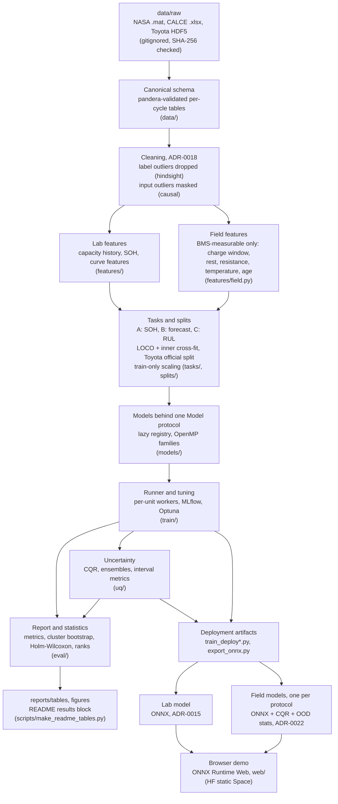

# Architecture

How raw cycler files become tables, models, calibrated intervals and a browser demo. The rules each stage must obey are in [PROTOCOL.md](../PROTOCOL.md); the reasons are in the [ADRs](decisions/README.md).

## Pipeline

## Stages in a sentence each
- **Data.** One loader per dataset writes the same canonical per-cycle table. Downloads are checksummed. Nothing here is committed.
- **Cleaning ([ADR-0018](decisions/0018-outlier-policy-and-field-inputs.md)).** Label outliers (CV-skip, partial charge, one-cycle glitch) are dropped with hindsight. Input outliers are masked using only past cycles. Enabled with the experiment's `clean` option.
- **Features.** The lab setting uses SOH history and, for the multi-channel variant, charge-phase channels. The field setting uses only BMS-measurable signals and forbids capacity-derived columns; a test corrupts the forbidden columns and checks the inputs do not change.
- **Tasks and splits.** Windows are causal and scalers are fitted on training cells only (leakage rules, `tests/test_leakage.py`). NASA and CALCE use leave-one-cell-out with cross-fitted inner folds; Toyota uses the official split.
- **Models.** Every model implements `Model` (`fit`, `predict`). Classes load lazily through the registry so torch and LightGBM never share a process on macOS.
- **Runner.** Experiments are Hydra configs. Each work unit logs to MLflow and is resumable. Tuning is equal-budget Optuna on Toyota ([ADR-0006](decisions/0006-equal-budget-tuning.md)).
- **Report and statistics.** Finished runs are aggregated into tables with cluster-bootstrap CIs, Holm-corrected Wilcoxon on Toyota and mean ranks.
- **Uncertainty.** Per-horizon CQR on held-out inner-fold predictions ([ADR-0011](decisions/0011-uq-method.md), [ADR-0019](decisions/0019-adaptive-intervals.md)). Interval metrics include the useful share.
- **Deploy.** The lab model ([ADR-0015](decisions/0015-deployment.md)) and the field models ([ADR-0022](decisions/0022-field-deployment.md)) are exported to ONNX with preprocessing folded in. The browser applies CQR and the OOD check in JavaScript, parity-tested against Python. Weights live on the Hugging Face model repo, never in git.

## Module map: `src/battery_rul/`
| Module | Role |
|---|---|
| `data/` | `nasa.py`, `calce.py`, `toyota.py` loaders; `schema.py` canonical contract; `io.py`, `download.py`; `quality.py` anomaly flags; `cleaning.py` outlier policy (ADR-0018); `toyota_field.py` capacity-free Toyota features |
| `features/` | `curves.py` Q(V), ICA, dQ(V); `field.py` BMS-measurable per-cycle features; `severson.py` early-cycle features for the Severson reproduction |
| `tasks/` | `eol.py` and `labels.py` EOL and RUL rules (ADR-0005); `samples.py` builds model-ready `SampleSet`s and feature sets (`field`, `field_curve`) |
| `splits/` | `loco.py` leave-one-cell-out with inner folds; `toyota.py` official and grouped splits; `scaling.py` train-only standardisation |
| `models/` | `base.py` protocol and `SampleSet`; `registry.py` lazy registry; baselines (`persistence`, `extrapolate`, `age`), `tabular` (ElasticNet, LightGBM), `linear`, `recurrent`, `transformer`, `patchtst`, `itransformer`, `recursive`, `neural` shared training |
| `train/` | `config.py` Hydra schema; `runner.py` experiments and MLflow; `tune.py` Optuna; `transfer.py` Toyota pre-training |
| `eval/` | `metrics.py`, `stats.py`, `report.py` |
| `uq/` | `conformal.py` CQR; `calibrate.py` post-hoc calibration; `ensemble.py`; `metrics_uq.py` coverage, width, useful share |
| `serve/` | `predictor.py` lab serving path (CPU only, validation, CQR, OOD); `field.py` field-mode serving (ADR-0022: same cleaning, scaling and windowing code as training) |
| `cli.py`, `utils.py` | `battery-rul` command line; seeding, device selection, paths |

Outside the package: `configs/` (Hydra experiment, model, tuned), `scripts/` (tables, figures, deploy, ONNX export, Hub upload), `web/` (browser demo and showcase), `app/` (local Gradio app), `reports/` (generated tables and figures, field EDA), `tests/` (synthetic-data unit tests; `tests/lgbm` runs separately).
