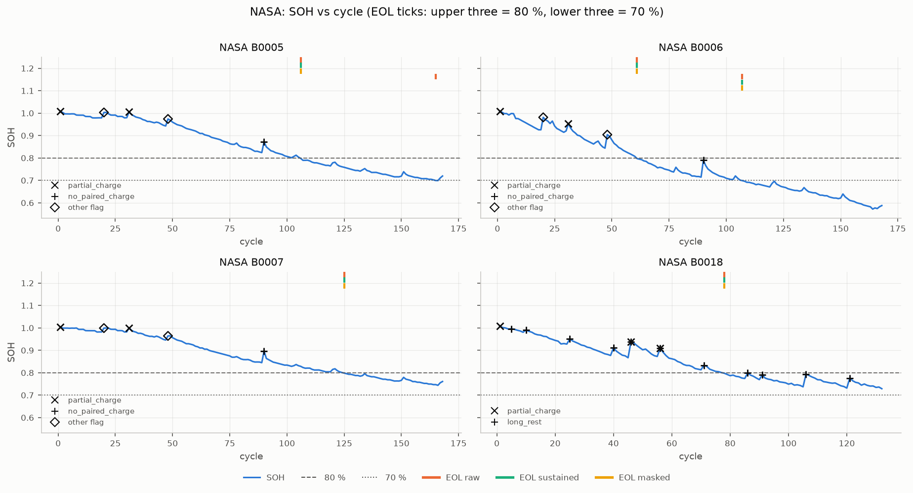
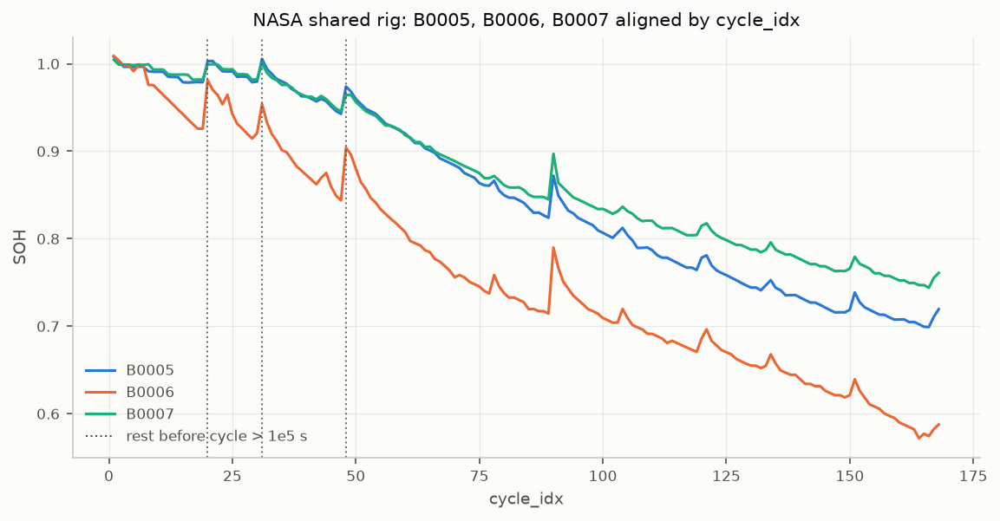
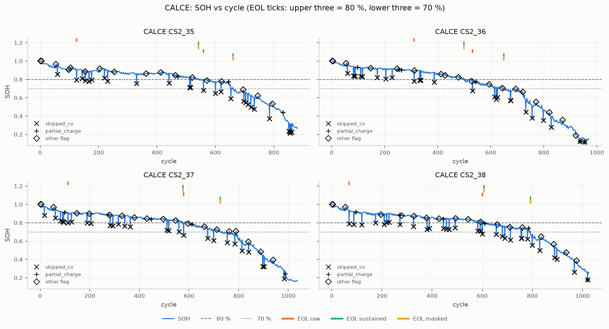
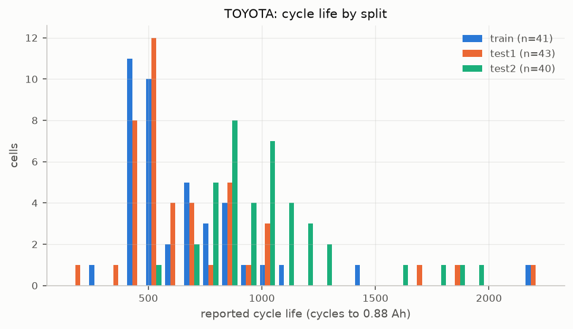
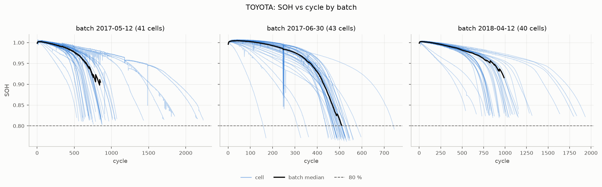
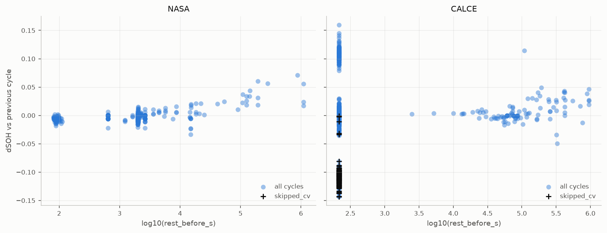
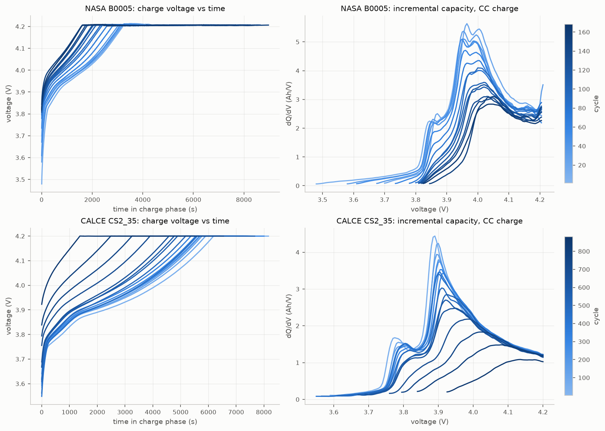

# Data-quality report (Phase 2)

_Generated by `scripts/make_data_quality_report.py`; every number below is computed from `data/processed/`. Do not edit by hand._

Datasets analysed: nasa, calce, toyota. Flags come from `battery_rul.data.quality.flag_anomalies` (derived; the parsed tables are untouched). EOL rules come from `battery_rul.tasks.eol` and are computed in hindsight on the full trajectory, which is legitimate for labels and never for model inputs.

## Flag definitions

| flag | rule | type |
|---|---|---|
| no_paired_charge | charge_time_s is NaN (no charge record before this discharge) | error |
| partial_charge | charge_throughput_ah < 0.5 x centered 21-cycle rolling median | error |
| skipped_cv | cv_time_s < 300 s (Arbin CV step ended after one sample) | error |
| long_rest | rest_before_s > 6 h | informational |
| capacity_jump | |capacity change| > 6 x centered 25-cycle rolling-median |change| | informational |
| charge_pause | charge_time_s > 3 x the cell's median charge_time_s (paused/interrupted charge) | informational + input cleaning (not an EOL mask) |

Causality (ADR-0005 section 6): partial_charge, capacity_jump use a centred rolling window (future cycles) and must not be model inputs as-is; charge_pause uses a whole-cell median, so a deployed model must recompute it causally.

Label mask used for the `masked` EOL rule: skipped_cv or partial_charge.

## NASA

### Per-cell overview and flag counts

| cell | n_cycles | first Ah | last Ah | min SOH | no_paired_charge | partial_charge | skipped_cv | long_rest | capacity_jump | charge_pause | masked (skipped_cv or partial) |
|---|---|---|---|---|---|---|---|---|---|---|---|
| B0005 | 168 | 1.856 | 1.325 | 0.699 | 1 | 2 | 0 | 3 | 13 | 0 | 2 |
| B0006 | 168 | 2.035 | 1.186 | 0.572 | 1 | 2 | 0 | 3 | 5 | 0 | 2 |
| B0007 | 168 | 1.891 | 1.432 | 0.744 | 1 | 2 | 0 | 3 | 11 | 0 | 2 |
| B0018 | 132 | 1.855 | 1.341 | 0.729 | 0 | 3 | 0 | 11 | 3 | 0 | 3 |

### EOL cycle at SOH < 80%

| cell | raw | rolling_median (w=5) | sustained (n=5) | masked (sustained) | rolling_median (w=11, sensitivity) | spread (max-min) |
|---|---|---|---|---|---|---|
| B0005 | 106 | 106 | 106 | 106 | 106 | 0 |
| B0006 | 61 | 61 | 61 | 61 | 61 | 0 |
| B0007 | 125 | 125 | 125 | 125 | 125 | 0 |
| B0018 | 78 | 78 | 78 | 78 | 78 | 0 |

Rule choice moves EOL by more than 50 cycles (or flips censoring) in **0 of 4** cells (spread over raw, rolling_median, sustained, masked; the w=11 column is not counted).

### EOL cycle at SOH < 70%

| cell | raw | rolling_median (w=5) | sustained (n=5) | masked (sustained) | rolling_median (w=11, sensitivity) | spread (max-min) |
|---|---|---|---|---|---|---|
| B0005 | 165 | censored | censored | censored | censored | **mixed (3/4 censored)** |
| B0006 | 107 | 107 | 107 | 107 | 107 | 0 |
| B0007 | censored | censored | censored | censored | censored | all censored |
| B0018 | censored | censored | censored | censored | censored | all censored |

Rule choice moves EOL by more than 50 cycles (or flips censoring) in **1 of 4** cells (spread over raw, rolling_median, sustained, masked; the w=11 column is not counted).

### SOH trajectories

_Black markers (x, +) are the two most frequent error-type flags in that panel; open diamonds fold the remaining error-type flags and long_rest into "other flag" (capacity_jump is not drawn, it marks too many cycles to read). Ticks at the top of each panel are EOL cycles: upper three bands 80 %, lower three bands 70 %._

### Shared rig

- `rest_before_s` agrees to within 1 s on **166 of 166** shared cycles across B0005, B0006, B0007 (all identical: True).
- Cycles with rest > 1e+05 s on all three: [20, 31, 48].
- Cycles with no paired charge on all three: [90].
- capacity_jump flagged on at least one of the three at 17 cycles, on all three at 3.
- Spearman rho of cycle-to-cycle dSOH between cells: B0005-B0006: 0.59, B0005-B0007: 0.69, B0006-B0007: 0.55.

- B0018 (separate rig/schedule): cycles with rest > 1e+05 s: [25, 40, 46, 56, 106, 121].

## CALCE

### Per-cell overview and flag counts

| cell | n_cycles | first Ah | last Ah | min SOH | no_paired_charge | partial_charge | skipped_cv | long_rest | capacity_jump | charge_pause | masked (skipped_cv or partial) |
|---|---|---|---|---|---|---|---|---|---|---|---|
| CS2_35 | 880 | 1.138 | 0.304 | 0.217 | 0 | 3 | 26 | 21 | 92 | 0 | 29 |
| CS2_36 | 970 | 1.145 | 0.172 | 0.120 | 0 | 6 | 25 | 23 | 118 | 0 | 29 |
| CS2_37 | 1036 | 1.135 | 0.191 | 0.161 | 0 | 5 | 27 | 25 | 105 | 0 | 32 |
| CS2_38 | 1025 | 1.140 | 0.290 | 0.181 | 0 | 6 | 31 | 24 | 112 | 0 | 36 |

### EOL cycle at SOH < 80%

| cell | raw | rolling_median (w=5) | sustained (n=5) | masked (sustained) | rolling_median (w=11, sensitivity) | spread (max-min) |
|---|---|---|---|---|---|---|
| CS2_35 | 125 | 542 | 542 | 542 | 544 | **417** |
| CS2_36 | 311 | 499 | 499 | 499 | 501 | **188** |
| CS2_37 | 112 | 575 | 575 | 575 | 574 | **463** |
| CS2_38 | 69 | 600 | 607 | 607 | 603 | **538** |

Rule choice moves EOL by more than 50 cycles (or flips censoring) in **4 of 4** cells (spread over raw, rolling_median, sustained, masked; the w=11 column is not counted).

### EOL cycle at SOH < 70%

| cell | raw | rolling_median (w=5) | sustained (n=5) | masked (sustained) | rolling_median (w=11, sensitivity) | spread (max-min) |
|---|---|---|---|---|---|---|
| CS2_35 | 559 | 655 | 661 | 661 | 658 | **102** |
| CS2_36 | 531 | 647 | 649 | 649 | 647 | **118** |
| CS2_37 | 578 | 726 | 726 | 726 | 726 | **148** |
| CS2_38 | 600 | 792 | 792 | 792 | 791 | **192** |

Rule choice moves EOL by more than 50 cycles (or flips censoring) in **4 of 4** cells (spread over raw, rolling_median, sustained, masked; the w=11 column is not counted).

### SOH trajectories

_Black markers (x, +) are the two most frequent error-type flags in that panel; open diamonds fold the remaining error-type flags and long_rest into "other flag" (capacity_jump is not drawn, it marks too many cycles to read). Ticks at the top of each panel are EOL cycles: upper three bands 80 %, lower three bands 70 %._

## TOYOTA

124 LFP/graphite A123 cells (Severson 2019). **EOL label = provider `cells.reported_cycle_life`** (label source `provider`, ADR-0005 Amendment 1): cycles to 0.88 Ah, 80 % of nominal. Per-cell EOL tables are omitted (one label per cell, no rule). Shared-rig and ICA figures are skipped: the curves are discharge-only and the charge protocol differs per cell (it is the experimental variable), so charge-curve shape is confounded with the protocol and cannot be read as ageing.

### Cycle life by split

| split | n | median | min | max |
|---|---|---|---|---|
| train | 41 | 527 | 300 | 2160 |
| test1 | 43 | 561 | 148 | 2237 |
| test2 | 40 | 964 | 541 | 1935 |

### Per-batch overview and flag counts

| batch | cells | median cycles recorded | median reported life | no_paired_charge | partial_charge | skipped_cv | long_rest | capacity_jump | charge_pause |
|---|---|---|---|---|---|---|---|---|---|
| 2017-05-12 | 41 | 840 | 842 | 0 | 0 | 0 | 0 | 986 | 19 |
| 2017-06-30 | 43 | 507 | 481 | 0 | 0 | 0 | 0 | 282 | 20 |
| 2018-04-12 | 40 | 964 | 964 | 0 | 0 | 1150 | 0 | 680 | 6 |

### Provider label vs the masked + sustained rule

The rule applied to our SOH (reference = mean of first 5 cycles, 1.04 to 1.10 Ah) censors most cells because the tests stop near 0.88 Ah, about 80 % of *nominal*, which is below 80 % of our reference. That is the reason for the amendment.

| threshold (SOH vs first-5-cycle mean) | cells | censored (masked + sustained) | resolved | median (rule - provider) | min / max (rule - provider) |
|---|---|---|---|---|---|
| 80% | 124 | 81 | 43 | 11 | 7 / 28 |
| 70% | 124 | 124 | 0 | n/a | n/a |

### SOH trajectories

_Thin lines: every cell; black: per-cycle batch median (drawn where at least half of the batch is still alive); dashed: 80 % SOH._

### Feature preview (charge-phase features vs SOH)

Spearman rho per cell, mean over cells with [min, max]. Charge features are protocol-dependent in Toyota, so read them within a protocol.

| feature | toyota, all cycles | toyota, masked cycles dropped |
|---|---|---|
| charge_time_s | +0.71 [-0.21, +1.00] | +0.71 [-0.21, +1.00] |
| cc_time_s | +0.99 [+0.91, +1.00] | +0.99 [+0.91, +1.00] |
| cv_time_s | -0.40 [-0.99, +0.99] | -0.41 [-0.99, +0.99] |
| charge_throughput_ah | +1.00 [+0.98, +1.00] | +1.00 [+0.98, +1.00] |
| charge_temp_max_c | n/a | n/a |
| charge_temp_mean_c | n/a | n/a |
| ir_ohm | -0.75 [-1.00, +0.08] | -0.75 [-1.00, +0.08] |
| rest_before_s | n/a | n/a |

## Cross-dataset

### Flag prevalence

| dataset | cells | cycles | no_paired_charge | partial_charge | skipped_cv | long_rest | capacity_jump | charge_pause |
|---|---|---|---|---|---|---|---|---|
| nasa | 4 | 636 | 0.5 % | 1.4 % | 0.0 % | 3.1 % | 5.0 % | 0.0 % |
| calce | 4 | 3911 | 0.0 % | 0.5 % | 2.8 % | 2.4 % | 10.9 % | 0.0 % |
| toyota | 124 | 100456 | 0.0 % | 0.0 % | 1.1 % | 0.0 % | 1.9 % | 0.0 % |

### Effect of each flag on SOH

Local deviation = SOH minus its centered 11-cycle rolling median. A flag that should be masked for labels shows a large flagged deviation relative to unflagged cycles.

| dataset | flag | n flagged | share of cycles | median signed dSOH vs local median (flagged) | median abs dSOH (flagged) | median abs dSOH (unflagged) |
|---|---|---|---|---|---|---|
| nasa | no_paired_charge | 3 | 0.5 % | 0.0492 | 0.0492 | 0.0010 |
| nasa | partial_charge | 9 | 1.4 % | 0.0167 | 0.0167 | 0.0006 |
| nasa | skipped_cv | 0 | 0.0 % | n/a | n/a | 0.0011 |
| nasa | long_rest | 20 | 3.1 % | 0.0201 | 0.0201 | 0.0005 |
| nasa | capacity_jump | 32 | 5.0 % | 0.0139 | 0.0139 | 0.0005 |
| nasa | charge_pause | 0 | 0.0 % | n/a | n/a | 0.0011 |
| calce | no_paired_charge | 0 | 0.0 % | n/a | n/a | 0.0019 |
| calce | partial_charge | 20 | 0.5 % | 0.0000 | 0.0064 | 0.0019 |
| calce | skipped_cv | 109 | 2.8 % | -0.1066 | 0.1066 | 0.0018 |
| calce | long_rest | 93 | 2.4 % | 0.0015 | 0.0038 | 0.0019 |
| calce | capacity_jump | 427 | 10.9 % | -0.0008 | 0.0044 | 0.0018 |
| calce | charge_pause | 0 | 0.0 % | n/a | n/a | 0.0019 |
| toyota | no_paired_charge | 0 | 0.0 % | n/a | n/a | 0.0000 |
| toyota | partial_charge | 0 | 0.0 % | n/a | n/a | 0.0000 |
| toyota | skipped_cv | 1150 | 1.1 % | 0.0000 | 0.0000 | 0.0000 |
| toyota | long_rest | 0 | 0.0 % | n/a | n/a | 0.0000 |
| toyota | capacity_jump | 1948 | 1.9 % | -0.0007 | 0.0008 | 0.0000 |
| toyota | charge_pause | 45 | 0.0 % | -0.0014 | 0.0020 | 0.0000 |

### Rule sensitivity summary

| dataset | threshold | cells | cells with spread > 50 or mixed censoring | median spread (uncensored cells) | max spread | cells censored under sustained |
|---|---|---|---|---|---|---|
| nasa | 80% | 4 | 0 | 0 | 0 | 0 |
| calce | 80% | 4 | 4 | 440 | 538 | 0 |
| nasa | 70% | 4 | 1 | 0 | 0 | 3 |
| calce | 70% | 4 | 4 | 133 | 192 | 0 |

### Regeneration vs rest

_dSOH vs previous cycle against log10(rest before the cycle); + marks skipped_cv cycles. Spearman rho: nasa: rho = 0.42 (all 629 cycles), 0.40 (615 cycles, masked cycles and the cycle after each dropped); rebounds (dSOH > +0.05 after rest < 1 h): 0, of which 0 follow a masked cycle; calce: rho = 0.04 (all 3907 cycles), 0.02 (3659 cycles, masked cycles and the cycle after each dropped); rebounds (dSOH > +0.05 after rest < 1 h): 103, of which 103 follow a masked cycle._

### Charge-curve evolution

_NASA B0005: 16 curves (cycles 10 to 161); CALCE CS2_35: 17 curves (cycles 50 to 850). ICA: charge_ah resampled onto a 5 mV voltage grid over the constant-current samples, Savitzky-Golay smoothed (window 9, order 3), then differentiated._

### Feature preview for Task A (charge-phase features vs SOH)

Spearman rho between a cycle's feature and its SOH, computed per cell; entries are the mean over cells with [min, max]. Only features available at charge time of cycle k.

| feature | nasa, all cycles | nasa, masked cycles dropped | calce, all cycles | calce, masked cycles dropped |
|---|---|---|---|---|
| charge_time_s | -0.06 [-0.25, +0.52] | -0.02 [-0.23, +0.59] | +0.96 [+0.95, +0.96] | +0.98 [+0.96, +0.98] |
| cc_time_s | +0.91 [+0.87, +0.93] | +0.99 [+0.96, +1.00] | +0.97 [+0.96, +0.98] | +0.99 [+0.99, +1.00] |
| cv_time_s | -0.86 [-0.91, -0.76] | -0.85 [-0.91, -0.75] | -0.74 [-0.83, -0.63] | -0.83 [-0.94, -0.72] |
| charge_throughput_ah | +0.92 [+0.89, +0.93] | +0.99 [+0.98, +1.00] | +0.99 [+0.99, +0.99] | +1.00 [+0.99, +1.00] |
| charge_temp_max_c | -0.07 [-0.35, +0.10] | -0.03 [-0.33, +0.13] | n/a | n/a |
| charge_temp_mean_c | +0.03 [-0.06, +0.11] | +0.06 [-0.02, +0.16] | n/a | n/a |
| ir_ohm | -0.82 [-0.96, -0.56] | -0.82 [-0.96, -0.56] | -0.81 [-0.97, -0.37] | -0.82 [-0.98, -0.37] |
| rest_before_s | -0.51 [-0.55, -0.41] | -0.54 [-0.57, -0.45] | +0.03 [-0.04, +0.07] | +0.03 [-0.05, +0.08] |

Discharge-phase quantities of the same cycle (not allowed as Task A inputs; shown to quantify the leakage):

| feature | nasa, all cycles | nasa, masked cycles dropped | calce, all cycles | calce, masked cycles dropped |
|---|---|---|---|---|
| discharge_time_s | +1.00 [+1.00, +1.00] | +1.00 [+1.00, +1.00] | +1.00 [+1.00, +1.00] | +1.00 [+1.00, +1.00] |
| discharge_energy_wh | +1.00 [+1.00, +1.00] | +1.00 [+1.00, +1.00] | +1.00 [+1.00, +1.00] | +1.00 [+1.00, +1.00] |
| discharge_temp_max_c | -0.78 [-0.89, -0.71] | -0.79 [-0.89, -0.71] | n/a | n/a |

## Carry-forward findings, quantified

**NASA discharge records (finding 2).**

| cell | v_min (cut-off) | median last discharge V | share of cycles ending > 0.1 V above cut-off | median |int|I|dt - capacity| / capacity | max |
|---|---|---|---|---|---|
| B0005 | 2.70 | 3.525 | 100.0 % | 0.2 % | 0.3 % |
| B0006 | 2.50 | 3.510 | 85.1 % | 0.9 % | 1.6 % |
| B0007 | 2.20 | 3.279 | 82.7 % | 1.5 % | 1.7 % |
| B0018 | 2.50 | 3.440 | 100.0 % | 0.8 % | 1.5 % |

**NASA charge records (finding 3).**

Cycle-1 charge throughput (Ah): B0005 0.7803, B0006 0.8502, B0007 0.8076, B0018 0.7838.

Cycles flagged partial_charge (cycle: Ah): B0005: 1: 0.780, 31: 0.008; B0006: 1: 0.850, 31: 0.044; B0007: 1: 0.808, 31: 0.035; B0018: 1: 0.784, 46: 0.169, 56: 0.027.

| cell | cycles with a negative current in first 4 charge samples | of | min current (A) |
|---|---|---|---|
| B0005 | 167 | 167 | -4.48 |
| B0006 | 167 | 167 | -4.48 |
| B0007 | 167 | 167 | -2.26 |
| B0018 | 132 | 132 | -4.51 |

**NASA SOH range and censoring (finding 4).**

| cell | min SOH | censored at 80 % (sustained) | censored at 70 % (sustained) |
|---|---|---|---|
| B0005 | 0.699 | False | True |
| B0006 | 0.572 | False | False |
| B0007 | 0.744 | False | True |
| B0018 | 0.729 | False | True |

**CALCE channels and ordering (finding 5).**

| cell | cycles | cycle_idx strictly increasing | charge_temp_max_c missing | ir_ohm available |
|---|---|---|---|---|
| CS2_35 | 880 | True | 100.0 % | 97.3 % |
| CS2_36 | 970 | True | 100.0 % | 97.3 % |
| CS2_37 | 1036 | True | 100.0 % | 97.4 % |
| CS2_38 | 1025 | True | 100.0 % | 97.4 % |

**CALCE equipment artifact vs real recovery (finding 6).**

| cell | skipped_cv cycles | share | mean dCapacity vs previous cycle at skipped_cv (Ah) | min / max | mean dCapacity at long_rest cycles, not skipped (Ah) | long_rest cycles |
|---|---|---|---|---|---|---|
| CS2_35 | 26 | 3.0 % | -0.121 | -0.163 / -0.013 | 0.0122 | 21 |
| CS2_36 | 25 | 2.6 % | -0.107 | -0.155 / -0.001 | 0.0106 | 23 |
| CS2_37 | 27 | 2.6 % | -0.124 | -0.144 / -0.106 | 0.0070 | 25 |
| CS2_38 | 31 | 3.0 % | -0.129 | -0.163 / -0.092 | 0.0066 | 24 |

EOL (80 %) by raw first crossing vs 11-cycle rolling median: CS2_35 125 vs 544; CS2_36 311 vs 501; CS2_37 112 vs 574; CS2_38 69 vs 603.

**CALCE cycled past EOL (finding 7).** Min SOH: CS2_35 0.22, CS2_36 0.12, CS2_37 0.16, CS2_38 0.18.

**Feature availability (finding 8)** is quantified by the discharge-feature table above.

## Recommendations for ADR-0005

- nasa @ 80%: rule choice moves EOL by > 50 cycles or flips censoring in 0/4 cells; |sustained - raw| max 0 cycles; |sustained - rolling_median(5)| max 0; masked equals sustained in 4/4 cells.
- calce @ 80%: rule choice moves EOL by > 50 cycles or flips censoring in 4/4 cells; |sustained - raw| max 538 cycles; |sustained - rolling_median(5)| max 7; masked equals sustained in 4/4 cells.
- nasa @ 70%: rule choice moves EOL by > 50 cycles or flips censoring in 1/4 cells; |sustained - raw| max 0 cycles; |sustained - rolling_median(5)| max 0; masked equals sustained in 4/4 cells.
- calce @ 70%: rule choice moves EOL by > 50 cycles or flips censoring in 4/4 cells; |sustained - raw| max 192 cycles; |sustained - rolling_median(5)| max 6; masked equals sustained in 4/4 cells.
- CALCE skipped_cv cycles sit 0.1066 SOH from their local median versus 0.0018 for unflagged cycles; CALCE long_rest cycles only 0.0038 (see the flag-effect table).

**Recommendation (lead decides).** Label EOL with `masked` + `sustained` (n=5), masking skipped_cv and partial_charge, at the 80 % threshold as primary and 70 % as a secondary (censoring-heavy on NASA). Raw first-crossing is not defensible on CALCE (numbers above). Keep long_rest and capacity_jump as inputs/diagnostics only (they describe real regeneration, not corrupt capacity values); mask only the artifact flags in labels.

**Strongest counter-argument.** Where the counts above show `masked` equal to plain `sustained`, the mask adds a hindsight-derived dependency without changing any label; `sustained` alone (or the centered median) is simpler, and the mask only pays off if artifacts cluster at the crossing.

